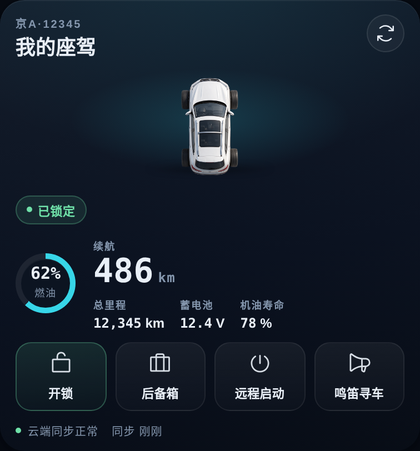

<div align="center">

# 爱车卡片 · ha-car

**给 [福特派互联（FordPass CN）](https://github.com/RockJesus/ha-fordpass-cn) / 林肯之道 做的一张仪表台级 Lovelace 卡片**

车况一屏读完 · 长按防误触控车 · 全可视化配置

[](https://github.com/RockJesus/ha-car/releases/latest)
[](https://www.home-assistant.io/)
[](https://hacs.xyz)
[](LICENSE)

</div>

<p align="center">
  
  
  
</p>

## 这是什么

一张替代「实体罗列卡」的车辆卡片。它按本车**实际具备的能力**渲染：汽油车不会出现充电模块，没有俯视图就自动退回 3D / 侧视图，实体缺失的模块整块不出现。

- **车辆驾驶舱视觉**：车型图作为主视觉，外圈双同心轨道 + 四枚发光节点；深蓝黑漆面 + 车机背光青，全卡只有一处强调色。
- **环形仪表**：燃油/电量与续航各占一枚 SVG 环形仪表，中心读数值，中间夹量纲图标；里程/电压/机油寿命收成一行小字。
- **一屏完成日常操作**：圆形玻璃操作钮（车锁、后备箱、远程启动、鸣笛、声光/灯光寻车），同步时间就是云端刷新入口。
- **长按防误触**：后备箱、开锁、上锁、远程启动、鸣笛默认需要按住 2 秒，松手太早只提示不动作；时长与动作清单都可改。
- **四轮胎压**：底部底座条一排四个读数，按「推荐胎压 / 胎状态」判据变色，异常那一格直接亮。
- **门窗开合态**：只显示真正开启的门/窗/尾门/引擎盖，全部关闭时收敛成一枚「已关闭」。
- **充电域按车型出现**：SOC、充电状态、立即/停止充电、家充桩、上次充电电量。
- **服务信息折叠区**：保养计划、召回、未读消息、车机固件、客服电话，不占主视觉高度。
- **执行反馈**：指令发出后按钮带脉冲点，等云端状态真正翻转才消；失败给明确报错。
- **车辆离线置灰**：`onlinernr` 判定离线时操作区降透明，避免按了没反应。

## 安装

### 市场（HACS）

1. HACS → 右上角菜单 → **自定义仓库**
2. 地址填 `https://github.com/RockJesus/ha-car`，类别选 **Dashboard / 前端插件**
3. 搜索「爱车卡片」→ 下载 → 浏览器强制刷新（App 需杀进程重开）

卡片是纯前端资源，**不需要重启 Home Assistant**。

### 手动

1. 下载 [`ha-car.js`](https://github.com/RockJesus/ha-car/releases/latest/download/ha-car.js)
2. 放到 `/config/www/ha-car.js`
3. 设置 → 仪表盘 → 资源 → 添加 `/local/ha-car.js`，类型 **JavaScript Module**

## 添加卡片

仪表盘 → 添加卡片 → 搜索「爱车卡片」，或直接写 YAML：

```yaml
type: custom:ha-car
```

**不需要填实体。** 卡片按「实体 ID 后缀 + 友好名后缀」识别槽位，账号下只有一辆车时连车辆都不用选；多辆车在可视化编辑器里选一台即可。

## 配置

| 键 | 类型 | 默认 | 说明 |
|---|---|---|---|
| `hash` | string | 自动 | 车辆标识（设备名或实体前缀），由编辑器选择车辆时写入；也可手填 |
| `device` | string | — | 也可直接给设备 ID，卡片只取该设备下的实体 |
| `title` | string | 设备名 | 卡片标题，默认取设备名（如Ford 椭圆标 + 「锐际 Escape」），其次取车辆昵称 |
| `show_plate` | bool | `true` | 顶部是否显示车牌 |
| `layout` | `full` / `compact` | `full` | `compact` 只留主视觉、状态、续航与操作，适合手机首屏；`full` 在宽屏（面板视图/桌面）自动变双栏：车图在左、仪表与副指标在右 |
| `modules` | list | 全部 | `status` `actions` `energy` `tires` `doors` `charging` `alerts` `service` |
| `confirm` | list | 5 项 | 需要长按的动作键，见下表 |
| `hold_ms` | number | `2000` | 长按时长（毫秒），300–3000 |
| `accent` | string | `#37d6e8` | 强调色（仪表背光青） |
| `image` | string | `auto` | `auto` / `overlook` / `3d` / `side` / `custom` / 实体 ID / URL |
| `image_url` | string | — | `image: custom` 时使用的图片地址 |
| `entities` | object | `{}` | 逐槽位覆盖实体，键名见下表 |

需要长按的动作键：`btn_unlock` 开锁、`btn_lock` 上锁、`btn_trunk` 后备箱、`sw_engine` 远程启动/熄火、`sw_honk` 鸣笛、`sw_va` 声光寻车、`sw_light` 灯光寻车。

```yaml
# 例子：只留车况与操作，开锁也要长按，强调色换成冰蓝
type: custom:ha-car
layout: compact
modules: [status, actions, energy]
confirm: [btn_unlock, btn_lock, btn_trunk, sw_engine]
accent: "#6ea8ff"
```

### 实体覆盖（可选）

实体 ID 被改过、或一台车挂了多个集成时，在 `entities` 里按槽位指定即可；其余槽位仍走自动识别：

```yaml
entities:
  fuel: sensor.my_fuel_level
  tracker: device_tracker.my_car
```

可用槽位：`lock` `online` `ignition` `remote_start` `tpms` `alarm` `fuel` `battery` `range` `ev_range` `odo` `volt` `oil` `tp_lf` `tp_rf` `tp_lr` `tp_rr` `door_fl` `door_fr` `door_rl` `door_rr` `tailgate` `hood` `win_fl` `win_fr` `tracker` `addr` `chg_status` `alerts` `maint` `recall` `messages` `sync` `data_time` `fw` `support` `btn_lock` `btn_unlock` `btn_trunk` `btn_refresh` `sw_engine` `sw_honk` `sw_va` `sw_light`。

## 操作反馈怎么读

| 现象 | 含义 |
|---|---|
| 按住后圆形按钮外圈走一圈青色进度 | 正在计时；走满后整圈变青、按钮震动、标签变「松手执行」，松手才发指令 |
| 轻点一下就松手 | 只弹「长按确认后执行」提示，不发指令 |
| 按钮右上角脉冲小点 | 指令已发出，等云端状态翻转（集成会跟随云端快照，通常十几秒到一分钟） |
| 底部青色条 | 指令已发送 / 刷新已请求 |
| 底部红色条 | 发送失败，带错误原因 |

## 与集成的对应关系

卡片读取的都是集成现有实体，不新增后端。车辆绑定分三步：

1. **认槽位**：用实体 ID 后缀和友好名后缀双线索。集成把中文实体名转成 pinyin 作为 `entity_id`（`sensor.<设备>_men_suo_zhuang_tai`），英文环境则是 translation key（`..._lock_status`），部分实体还是历史英文名（`button.<设备>_lock_doors`）；三条都给 `lock` 之类的槽位对上号。
2. **认车辆**：优先用实体注册表的 `device_id` 分组；没有注册表时退回「友好名共同前缀」（如Ford 椭圆标 + 「锐际 Escape」），不会把电风扇、门锁这类同后缀实体算成车。
3. **认配置**：`hash` / `device` / 单车辆自动。

状态值按中英文模糊匹配（`已锁定` / `locked`、`开启` / `open`、`故障` / `fault`），界面语言切换后照样成立；充电中优先读 `charging_status` 的 `evcc_charge_state` 属性。

## 面板模式（全屏视图）

仪表盘用 `type: panel` 建视图、整页只放这张卡时，卡片会按 **1440×900 的设计稿等比缩放**：

- 卡片宽高撑满容器，一屏放下全部信息，不出现滚动条；
- 宽或高任一方向先到顶时，另一方向按比例扩展画布（不是拉伸像素），横屏、4:3 与超宽面板都能两个方向铺满、不留黑边；
- 1440/1920/2560 桌面与 4K 大屏按同一套版心缩放；手机面板（<900px）不缩放，走常规自适应；
- 内容宽度与车图在一屏内自动分配。

## 车况叠图（俯视图上的图标徽章）

车门、车窗、引擎盖、尾门与四轮胎压不再排在卡片底部，而是按真实方位以**图标徽章**叠在车型俯视图两侧，徽章里直接显示状态：

| 位置 | 图标 | 徽章内容 |
|---|---|---|
| 车头 | 发动机图标 | 中央显示「关闭 / 打开 / 不可用」，下方小字「引擎盖」 |
| 车尾 | 尾门图标 | 中央显示尾门状态，下方小字「尾门」 |
| 车身左列（主驾门 → 主驾窗 → 左后门 → 左后窗） | 车门图标 | 中央显示状态，下方小字标出部位 |
| 车身右列（副驾门 → 副驾窗 → 右后门 → 右后窗） | 车门图标 | 同上 |
| 四轮位圆形徽章 | 轮胎图标 | 中央胎压数值（kPa），下方单位；压力越界才转琥珀 |

- 徽章位置由 JS 量出车图真实矩形后贴上去，换图、缩放、面板模式都不会错位；门窗列与胎压徽章都排在车身轮廓之外，不遮挡俯视车图；
- 手机窄面板自动收紧为小号徽章（30px 门窗 / 34px 胎压），并把门窗列改成相对车图中心的像素偏移，保证一屏铺满不滚动；
- 每一路都能在编辑器「高级：实体绑定」里单独指定实体（`door_fl/door_fr/door_rl/door_rr`、`win_fl/win_fr/win_rl/win_rr`、`hood`、`tailgate`、`inner_tailgate`、`lock`），留空即自动识别；编辑器里还有一键「自动适配集成实体」，点一下会把当前识别到的实体逐项填好；
- 有任一车门/车窗开启时，下方会补一行文字明细（如「主驾门 · 开启」），全关时不占高度。


## 竖屏平板自适应（v1.7.1）

竖屏平板（834×1112）曾被判进双栏 `fit` 版式：横版画布被判成 `1440×1823` 的竖条，内容挤在中间、上下各空一大块。现在 `fit` 只在「宽 ≥ 高」的容器里启用（`w >= h * 1.02`），竖屏走单列 `pfit` 等比铺满，手机与平板都是满屏无滚动。

## 面板铺满修复（v1.7.0）

超宽屏（如 3432×1274）下面板画布只占中间一块、两侧大片空白，根因有三层：

1. `_fitPanel()` 只在挂上 `panel` 时算一次，量到的是 HA 布局尚未收敛的中间宽度（1948 而非 3176），之后再也不重算。
2. 宿主高度是 `height:100%`，里面画布是绝对定位，容器和画布互相撑大 → 量到的高度会自激变大（曾涨到 1717）。
3. 画布高度写死 `max(900, h/k)`，宽受限时会高出容器，被 `overflow:hidden` 裁掉。

修法：
- 面板模式下用 `_pinHostSize()` 把宿主钉成「视口宽高减左上偏移」的确切像素，切断自激。
- 宿主持久 `ResizeObserver` + `window.resize` + 首帧后 260/700/1400ms 三次补算，尺寸没变就跳过。
- 画布按容器等比反算，宽高都补到容器边界；宽而矮的面板（≥760×460）改用双栏 `fit` 版式，不再退化成手机单列版式放大。

## 状态文案与图标（v1.6.9）

- 圆环内所有状态胶囊统一用「已关闭 / 已打开」，与集成上报的实体值一致；异常仍显示「不可用」。
- 状态行改为图标 + 文字整组居中，不再左侧固定留白；文字 `nowrap` 防换行。
- 车门 / 车窗 / 胎压改用新画的**描边线条图标**（`STROKE_PATHS`）：车门是带门把手的门板、车窗是带中分线的窗框、胎压是轮胎的外胎+内圈。原来的 `wheel` 图标在 `PATHS` 里并不存在，`icon()` 回退成汽车剪影，这就是之前胎压那一行看着不像轮胎的原因。

## 回退记录（v1.6.8 → v1.6.7）

v1.6.8 把前灯从径向光斑改成硬边梯形投影，上线后判定不如 v1.6.7 的光扇自然，已整体回退：线上与源码都回到 v1.6.7 的灯光参数（光锥 27cqw 径向渐变、地面落光 112cqw、尾灯带 + 车后红光 108cqw）。后续优化以 v1.6.7 为基线，从 v1.6.9 起继续。

## 前灯改硬边投影（v1.6.8）

- 前灯光锥从「径向光斑」改成**线性渐变的梯形投影**：两侧边是干净的直边（`clip-path` 梯形），纵向从灯口最亮一路淡出到远端消失，中心再加一条 46% 宽的核心光束，读起来就是「前灯向前打出的切光」，而不是两团雾。
- 光锥模糊从 2.4px 收到 3px 以内的软边（保留清晰轮廓又不玻璃板化）。
- 地面落光下移到光锥 72% 处、128cqw×21cqw 的扁椭圆，亮度略低于灯口，形成「灯口亮—地面铺开—远端淡出」三段。
- 车后红光扩到 126cqw×34cqw，往车身两侧各展开约 10%，车尾左右角也被染红。

## 车灯加强（v1.6.7）

前灯光锥加宽加亮（27cqw，中心 α 1.0、核心层 1.0），地面落光扩到 112cqw×26cqw 且中心拉满不透明度；尾灯带亮度提到 1.0、光晕加强，车后红光扩到 108cqw×32cqw。启动状态下前后灯一眼可见，熄火后节点全部移除。

## 车灯范围与位置校准（v1.6.6）

- 前灯范围收窄到 24cqw，光锥只从实测灯位（x 29.9%/70.2%、y 10.6%）射向车头前方，外张角度收到 5°，不再像两扇白墙。
- 光锥长度按 hero 真实空间取值（lineY−2，且不超过车身高的 30%），顶端在 hero 上沿自然淡出，不留生硬截断。
- 地面落光（.gpool）下移、加宽到 96cqw，放在光锥 82% 处，亮度高于光锥本身，读起来是「光打在环内地面上」。
- 尾灯改成两层：灯带本体（.tailbar，55cqw 宽，精确压在实测尾灯带 y 73.4%）+ 车后地面红光（.tailglow，94cqw 宽，y 87.5%），近处灯亮、远处地面被染红。

## 灯光落地感（v1.6.5）

回到 v1.6.3 的光效语言（明亮白色前灯切光 + 车尾红色光区），但不再保留任何椭圆光圈：前灯两束光锥从车头灯位（x 29.9%/70.2%、y 10.6%）射出并向外 7° 张开，光锥末端新增一片椭圆形的地面落光，让光看起来打在环内的地面上，而不是悬浮在空中；尾灯保留车尾的大片红色地面光区。

## 灯光按灯位对齐（v1.6.4）

去掉上一版四个椭圆光圈，只保留两束光：前灯切光从车头灯位（实测 x 29.9%/70.2%、y 10.6%，对应官方车图前灯中心）射出，向上张开、顶端齐平切断；尾灯换成一条覆盖车尾红灯带的红色光带（x 23.6%–76.4%、y 73.4%），两侧渐隐、带外溢光晕，正好压在车图自带的红色尾灯区域上。

## 前灯切光 / 尾灯红区（v1.6.3）

前灯从「两个小亮点」改成真正的光锥：左右各一束冷白切光，向前（车头方向）张开、远端齐平收边，光锥高度由 JS 按 hero 顶部到车灯线的实际距离算，正好顶到 hero 上沿，不会被裁成断头；尾灯改成一片铺在车后的红色光区，加宽到车宽 86%、向下溢出车尾，形成明显的红色范围光。

## 引擎启动的前后车灯（v1.6.2）

远程启动时，车图前部两侧亮起冷白头灯、尾部亮起红色尾灯，与车底呼吸绿光同频（2.6s，左右错相 0.16s）；熄火后灯光节点直接从 DOM 移除。灯光用 `cqw` 定位在车图坐标系（前灯 `top 8.8%`、尾灯 `top 77.4%`），任何分辨率都贴在真实灯位，不随圆环或卡片缩放跑偏。

## 圆环按可见区域定径（v1.6.1）

圆环直径不再用 `min(hero 宽, hero 高)`：改成以 hero 圆心为参考，量到「hero / .wrap / ha-card 三者交集」的最短半径来定径，并把该交集之外的部分全部让出。这样即使面板缩放、祖先容器裁切、hero 比可见区域更大，圆环弧线也不会被切掉任何一段；同时新增 `ResizeObserver` 监听 hero，布局变化立即重算。

## 圆环光效不裁切（v1.6.0）

呼吸光效从「外发光 box-shadow」改为「内发光 + 描边提亮」：外发光会被 hero 的裁切边切出直边（尤其手机上圆环几乎贴着卡片边缘），内发光完全落在环内，任何尺寸都不会出现直边。同时 `.hero` 继续保持 `overflow: hidden`，不产生额外滚动溢出。

## 引擎胶囊两行化（v1.5.9）

引擎状态胶囊改两行（`引擎` / `已启动·已熄火`），整体尺寸随圆环半径缩放（0.82–1.1），并用「四角里离圆心最近的那个角到圆心距离 ≥ 半径 + 8px」的几何约束把整块推到圆环外，不再压住环线；同时被 hero 边界与主驾卡片自动避让。

## 引擎启动特效（v1.5.8）

车辆远程启动后，车底大圆环切到赛博朋克绿并持续呼吸（2.6s `box-shadow` + 光环脉动，外层副环错相 0.7s），车底地面光同步呼吸；熄火即全部停止。圆环左上角圈外新增引擎状态胶囊：「引擎 · 已启动」带绿色脉动点与辉光，「引擎 · 已熄火」为灰色静置。胶囊按「右下角到圆心距离 ≥ 半径 + 8px」的几何约束自动推到圆环外，并随分辨率缩放。

## 胶囊自适应定位（v1.5.7）

四张位置卡与前后盖胶囊不再写死百分比：运行时按「车身轮廓（图宽 10%–90%、图高 5.8%–85.5%）+ 圆环边界」算出可用走廊，卡片内缘贴车身外侧 4px、竖向对齐前后车门行（车身高 34% / 66%），外侧不越环线；走廊不足时卡片等比缩小，仍不足则先把圆环最多收 28% 给前后盖胶囊腾空间。360×780 这类窄屏从"胶囊压环线"变为"圆环内收、胶囊完整"，宽屏则卡片贴车身、空格均匀。

## 车身居中（v1.5.6）

官方俯视图上留白 5.8%、下留白 14.5%，车图整体居中时车身视觉重心偏上。现在车图整体下移约 4.3% 图高（有圆环余量约束，不会撞到环底），让车身中心与圆环圆心重合；状态层随之同步下移，前后盖胶囊仍贴车身头尾。

## 尾门锚点修正（v1.5.5）

官方俯视图底部有一段很淡的投影，alpha 边界（91.7%）比真正看得见的车尾（约 85.5%）多出一截，导致尾门胶囊悬在投影下方像"没吸附"。现按实际车身边界 85.5% 锚定，尾门胶囊紧贴后保险杠；同时补上 `object-fit: contain` 的居中留白换算。

## 前后盖卡贴车头车尾（v1.5.4）

引擎盖/尾门胶囊不再居中悬在圆环与车图之间，而是按车身轮廓（图高 5.6%–98.7%）贴到车头、车尾外侧 3–5px；圆环边距不够时自动被圆环约束住，保证不压环线。

定位同时处理了面板整体缩放带来的坐标差：圆环 rect 会先按 `clientWidth / rect.width` 换算回布局像素，再和胶囊高度比较，避免缩放面板里算错位置。

## 仪表内部自适应（v1.5.3）

仪表中心的三层文字（标签、数值、单位）和标签图标改成容器查询单位（`cqw`），数值约等于圆圈直径的 26%，小屏有 18px 下限、大屏 44px 上限，所以手机、平板、宽屏下文字与圆环的比例一致，不再出现"大圈里一小坨字"。

## 仪表光效（v1.5.2）

燃油/续航环的光晕此前被 SVG 元素边界裁成方块，现在让 `svg` 与 `.gauge` 都 `overflow: visible`，光晕在环外自然扩散；中间分隔线高度从固定 78px 改成 62%，随仪表尺寸自适应。

## 位置卡贴边（v1.5.1）

四张位置卡（主驾/副驾/左后/右后）的内缘按车图宽度的 7.5% / 92.5% 锚定，正好贴着车身轮廓外侧留 3–6px 呼吸位，任意屏幕宽度、任意车图比例都等比自适应，既不盖车也不越圆环。

## 前后盖卡落位（v1.5.0）

引擎盖与尾门小卡不再按固定百分比摆放，而是运行时量出「圆环边」与「车图边」之间的空隙、居中对齐：空隙够就浮在空隙里，不够（小屏）就贴在车头/车尾内侧，两种情况都不压圆环线。

圆环直径改按 hero 短边 96.5% 定径，手机端车图略收窄（74%），保证上下都留出卡片空间。标题行改为 flex：车型过长时省略号截断，车牌始终完整显示。

## 头部排版（v1.4.9）

车牌不再单独占一行，改为接在车型标题后面（同基线、小一号、带字距的浅色等宽字体）；位置与刷新时间上移到标题下一行，省出的一行高度留给车况区。

## 车况聚合卡（v1.4.8）

每个车门一张聚合卡：位置名 + 锁状态图标 + 门开合 + 窗开合 + 该轮位胎压，四张卡分别落在主驾/副驾/左后/右后，全部位于大圆圈内侧且不遮车身与圆环线。

- 尺寸用容器查询单位（`cqw` 相对车图层宽度），卡片、图标、字号随车图等比缩放，手机与宽屏面板同一套排版。
- 圆环改为按 hero 短边定径（`min(w,h) × 94%`），宽屏面板不再被左右裁切，始终是完整圆形。
- 引擎盖、尾门保留独立小卡，放在车头/车尾正上方与正下方，同样在圆环内。
- 状态色：卡片内门/窗打开或胎压越界，对应行变琥珀；整卡描边随任一项异常提亮；传感器不可用转红。

## 车况卡片（v1.4.7）

车门、车窗、引擎盖、尾门、四轮胎压统一成同一套信息卡：左侧图标、右侧两行文字（状态 + 位置），玻璃底 + 描边 + 投影，圆角 11px；手机面板整体缩一档。

- 位置按真实方位：左右两列悬停车身左右边缘外侧（按车图透明留白折算 90% 锚点），前后盖挂在车头/车尾正外侧，不再压车身。
- 胎压卡：轮胎图标 + 大字数值 + 小字单位（kPa），副行标位置（左前/右前/左后/右后）。
- 状态色统一：关闭/正常为冷色；打开或胎压越界换琥珀色描边与数值；传感器不可用转红。
- 胎压只按压力区间判定告警（<190 或 >300 kPa），继承集成侧误报时不再逐轮泛黄。

## 选择器缩略卡（v1.4.6）

“添加卡片”选择器里的缩略图会走独立版式：卡高固定 186px，只画标题 + 锁态胶囊 + 车图占位 + 双环仪表，不渲染车况/按钮/告警，避免整张面板卡被塞进小格子撑破选择器。

判定同时接受 HA 传入的公开 `preview` 属性、祖先链命中 `hui-card-picker` / `ha-card-picker` / 添加-编辑卡片弹窗，并在挂载后（`connectedCallback`）重新判定一次——因为 `setConfig` / `set hass` 通常发生在元素挂到 DOM 之前。

## 长按反馈（v1.4.5）

手指按住圆钮时会把按钮上的进度环挡住，所以长按进度改成三条互不重叠的反馈：

- **车底轨道圈转满一圈**：按住时从 12 点方向顺时针扫过一圈高亮弧线，走满整圈即长按完成；弧线在车图外围，手指完全挡不住；松手或被打断立刻熄灭。
- **分段震动**：按住到 30% / 70% 各轻震一次（15ms / 20ms），到时长强震一次（40ms），不看屏幕也能数拍子。
- **按钮标签倒计时**：按住期间按钮下方文字临时变成“继续按住 1.2s”，到时长变“松手执行”，文字在按钮外侧，指尖盖不到。

## 提示气泡（v1.4.3）

长按防误触的提示、操作成功/失败反馈不再插进正文流里，而是变成控制区上方右侧的一枚浮动气泡（绝对定位、`pointer-events:none`）：不占高度、不挤压车图与仪表，4 秒后自动消失；错误态换成红色边框与红色文字。

## 控制按钮（v1.4.2）

四枚圆钮固定为 **开锁 / 关锁 / 远程启动 / 鸣笛寻车**：开锁与关锁并列常显（不再按当前锁态切换成单颗），后备箱按钮位被关锁替代；当前处于锁定态时「关锁」亮绿环，处于解锁态时「开锁」高亮。长按确认项里也移除了后备箱。

## 信息密度（v1.4.1）

- 环形仪表里的数值与单位改上下排布，任何位数都不会顶出圆环；
- 「总里程 / 蓄电池 / 机油寿命」每项内部单排（名称 + 数值 + 单位同行）；
- 车辆告警压成一行（标题 + 内容，超长省略号）；
- 底部两条胶囊换成集成的下拉实体：**寻车时长** 绑 `select.*持续时长`、**寻车类型** 绑 `select.*类型`，点开即系统选择器，选中直接 `select.select_option` 生效；
- 车头 Ford 椭圆标放大到 46×21。

## 自定义模块（v1.4.0）

卡片内所有内容都是「模块」，在编辑器「模块布局」里可自由调整：

| 操作 | 说明 |
|---|---|
| 排序 | 每行 ↑ / ↓ 按钮上下移动；手机按此顺序从上到下，宽屏车图固定左栏、其余按顺序排右栏 |
| 显隐 | 每行右侧开关，关掉即不渲染、不占高度 |
| 删除 | 每行 ✕；内置模块删掉后可用「添加模块」再加回 |
| 添加 | 底部「添加模块」下拉可选：定位/同步、车图、能耗仪表、车辆告警、门窗、充电、服务信息、控制按钮、自定义实体 |
| 自定义实体 | 选择任意实体 + 显示名称 + 单位，卡片会渲染成一条「图标 + 名称 + 数值 + 单位」的信息条 |

- 车图是固定锚点（首个模块 / 宽屏左栏），避免俯视图与徽章错位。
- 配置字段：`blocks: [{ type, on, entity, label, unit, icon }]`。不写 `blocks` 的旧配置会按 `modules` 自动推导等价顺序，无需迁移。
- 模块级的实体绑定：`custom` 用 `entity` 指定实体；`meta` 的 `entity` 可换成自定义定位/地址实体；`hero` 的 `entity` 可换成自定义车辆图片实体。

## 布局顺序（v1.3.2）

- 顶部：车型名 + 锁态胶囊；胶囊下面紧跟一条 **定位 + 同步时间** 的紧凑信息行（地址超长自动省略号）；
- 中部：俯视车图与车况徽章、双环形仪表、三项副指标；
- 下部：车辆告警条；
- 最底部：四枚圆形控制钮与两枚长按条（控制区固定在最后，不再被信息条挤到中间）；
- **服务信息默认不渲染**，需要时在编辑器「显示模块」里勾选 `service` 即可，勾掉后不占高度。

## 面板一屏自适应（手机 / 平板 / 桌面）

面板模式（`/lovelace/hacar` 这类整屏视图）下，卡片会按容器尺寸整体等比缩放，保证**一屏铺满且绝不出现滚动条**：

- 宽 ≥900 且高 ≥620：按 1440×900 设计稿等比铺满（车图在左、仪表与操作在右栏）；
- 手机 / 平板竖屏：按 390×840 的竖版稿等比缩放，画布宽度由容器反算（canvas = 容器 ÷ 缩放），所以左右、上下都铺满，不会出现黑边；
- 缩放只做等比 transform，字阶、圆角、间距关系不变，不会出现某块被拉扁。

## 视觉（v1.2.0 概念稿对齐）

对齐初版概念稿的仪表台语汇，做了一轮整体美化：

- 卡片：更深的海军蓝渐变 + 顶部高光线 + 细密网点纹理（向下淡出），玻璃拟态边框与青色外发光；
- 主视觉：车图放大、青色轨道环加亮，四枚节点改成带双层光晕的小光点，车底阴影加深；
- 仪表：环形加粗到 6px、渐变青光晕，数值字号放大，「燃油 / 续航」标签改用大写小字距；
- 副指标：三项合并成一条玻璃长条（内部细分隔线），不再是三个小方块；
- 操作钮：发光玻璃圆钮，悬停与长按沿圆环走一圈的动效保留；
- 告警：左侧加一条红色渐变指示条，玻璃底更突出；
- 宽面板（1440 设计稿）：车图满列、仪表/操作/告警/信息叠成右栏，整块内容垂直居中，不再出现大片留白。

## 脱敏显示（分享截图用）

默认关闭，开启后卡片仍然实时联动，只改呈现：

- **车牌**：只留省份简称 + 字母位，其余打点（`蒙A•••••`）。
- **地址**：只留两级行政区，街道门牌换成省略号（`内蒙古自治区呼和浩特市…`）。
- **服务信息**：长数字（电话、工单号）与类 VIN 串打码，保留前几位便于核对。
- **车型图**：优先走 HA 图片代理（`/api/image_proxy/...`），浏览器不再直连第三方 CDN。

```yaml
type: custom:ha-car
hash: 我的车
privacy: true
```


## 排错

| 现象 | 处理 |
|---|---|
| 卡片显示「没找到车辆实体」 | 确认福特派互联集成已加载、实体可用；仍不行就在编辑器里手动选车辆，或用 `entities` 覆盖单个槽位 |
| 顶部车辆图是空的 | 集成没提供车型图可直接用 `image: custom` + `image_url` 指定一张 |
| 胎压/告警不亮 | 集成上报的是文字状态（`故障` / `系统故障`），卡片已同时匹配 `fault` / `warn` / `异常` / `故障` |
| 改了新版还是旧样式 | 市场升级后浏览器强刷；App 杀进程重开 |

## 开发

```bash
npm install
npm run build      # esbuild 打成单文件 ESM → ha-car.js
npm run lint
python3 scripts/check_bundle.py
```

`dev/harness.html` 是带 mock 实体的渲染台，浏览器直接打开即可改样式看效果（需要起一个静态服务器，ESM 不能走 `file://`）。

## 版本

三段十进制，段内不进两位数：`1.0.9` 之后是 `1.1.0`。变更见 [Releases](https://github.com/RockJesus/ha-car/releases)。

## 免责声明

个人自用项目，与福特汽车（中国）、长安福特、林肯中国**无任何关联、未获授权**；「福特派」「林肯之道」商标归各自权利人所有，此处仅用于说明对接对象。卡片只做本机前端渲染，不向任何第三方上传数据。使用风险自负。
