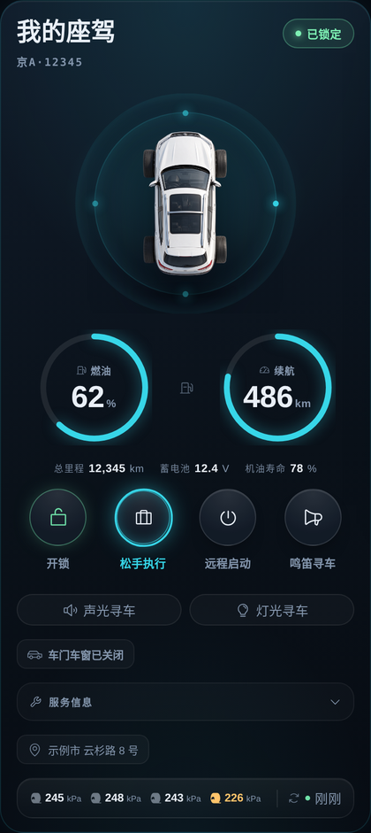

<div align="center">

# 爱车卡片 · ha-car

**给 [福特派互联（FordPass CN）](https://github.com/RockJesus/ha-fordpass-cn) / 林肯之道 做的一张仪表台级 Lovelace 卡片**

车况一屏读完 · 长按防误触控车 · 全可视化配置

[](https://github.com/RockJesus/ha-car/releases/latest)
[](https://www.home-assistant.io/)
[](https://hacs.xyz)
[](LICENSE)

</div>

<p align="center">
  
  
  
</p>

## 这是什么

一张替代「实体罗列卡」的车辆卡片。它按本车**实际具备的能力**渲染：汽油车不会出现充电模块，没有俯视图就自动退回 3D / 侧视图，实体缺失的模块整块不出现。

- **车辆驾驶舱视觉**：车型图作为主视觉，外圈双同心轨道 + 四枚发光节点；深蓝黑漆面 + 车机背光青，全卡只有一处强调色。
- **环形仪表**：燃油/电量与续航各占一枚 SVG 环形仪表，中心读数值，中间夹量纲图标；里程/电压/机油寿命收成一行小字。
- **一屏完成日常操作**：圆形玻璃操作钮（车锁、后备箱、远程启动、鸣笛、声光/灯光寻车），同步时间就是云端刷新入口。
- **长按防误触**：后备箱、开锁、上锁、远程启动、鸣笛默认需要按住 0.7 秒，松手太早只提示不动作；时长与动作清单都可改。
- **四轮胎压**：底部底座条一排四个读数，按「推荐胎压 / 胎状态」判据变色，异常那一格直接亮。
- **门窗开合态**：只显示真正开启的门/窗/尾门/引擎盖，全部关闭时收敛成一枚「已关闭」。
- **充电域按车型出现**：SOC、充电状态、立即/停止充电、家充桩、上次充电电量。
- **服务信息折叠区**：保养计划、召回、未读消息、车机固件、客服电话，不占主视觉高度。
- **执行反馈**：指令发出后按钮带脉冲点，等云端状态真正翻转才消；失败给明确报错。
- **车辆离线置灰**：`onlinernr` 判定离线时操作区降透明，避免按了没反应。

## 安装

### 市场（HACS）

1. HACS → 右上角菜单 → **自定义仓库**
2. 地址填 `https://github.com/RockJesus/ha-car`，类别选 **Dashboard / 前端插件**
3. 搜索「爱车卡片」→ 下载 → 浏览器强制刷新（App 需杀进程重开）

卡片是纯前端资源，**不需要重启 Home Assistant**。

### 手动

1. 下载 [`ha-car.js`](https://github.com/RockJesus/ha-car/releases/latest/download/ha-car.js)
2. 放到 `/config/www/ha-car.js`
3. 设置 → 仪表盘 → 资源 → 添加 `/local/ha-car.js`，类型 **JavaScript Module**

## 添加卡片

仪表盘 → 添加卡片 → 搜索「爱车卡片」，或直接写 YAML：

```yaml
type: custom:ha-car
```

**不需要填实体。** 卡片按「实体 ID 后缀 + 友好名后缀」识别槽位，账号下只有一辆车时连车辆都不用选；多辆车在可视化编辑器里选一台即可。

## 配置

| 键 | 类型 | 默认 | 说明 |
|---|---|---|---|
| `hash` | string | 自动 | 车辆标识（设备名或实体前缀），由编辑器选择车辆时写入；也可手填 |
| `device` | string | — | 也可直接给设备 ID，卡片只取该设备下的实体 |
| `title` | string | 设备名 | 卡片标题，默认取设备名（如「锐际 Escape」），其次取车辆昵称 |
| `show_plate` | bool | `true` | 顶部是否显示车牌 |
| `layout` | `full` / `compact` | `full` | `compact` 只留主视觉、状态、续航与操作，适合手机首屏；`full` 在宽屏（面板视图/桌面）自动变双栏：车图在左、仪表与副指标在右 |
| `modules` | list | 全部 | `status` `actions` `energy` `tires` `doors` `charging` `alerts` `service` |
| `confirm` | list | 5 项 | 需要长按的动作键，见下表 |
| `hold_ms` | number | `700` | 长按时长，300–3000 |
| `accent` | string | `#37d6e8` | 强调色（仪表背光青） |
| `image` | string | `auto` | `auto` / `overlook` / `3d` / `side` / `custom` / 实体 ID / URL |
| `image_url` | string | — | `image: custom` 时使用的图片地址 |
| `entities` | object | `{}` | 逐槽位覆盖实体，键名见下表 |

需要长按的动作键：`btn_unlock` 开锁、`btn_lock` 上锁、`btn_trunk` 后备箱、`sw_engine` 远程启动/熄火、`sw_honk` 鸣笛、`sw_va` 声光寻车、`sw_light` 灯光寻车。

```yaml
# 例子：只留车况与操作，开锁也要长按，强调色换成冰蓝
type: custom:ha-car
layout: compact
modules: [status, actions, energy]
confirm: [btn_unlock, btn_lock, btn_trunk, sw_engine]
accent: "#6ea8ff"
```

### 实体覆盖（可选）

实体 ID 被改过、或一台车挂了多个集成时，在 `entities` 里按槽位指定即可；其余槽位仍走自动识别：

```yaml
entities:
  fuel: sensor.my_fuel_level
  tracker: device_tracker.my_car
```

可用槽位：`lock` `online` `ignition` `remote_start` `tpms` `alarm` `fuel` `battery` `range` `ev_range` `odo` `volt` `oil` `tp_lf` `tp_rf` `tp_lr` `tp_rr` `door_fl` `door_fr` `door_rl` `door_rr` `tailgate` `hood` `win_fl` `win_fr` `tracker` `addr` `chg_status` `alerts` `maint` `recall` `messages` `sync` `data_time` `fw` `support` `btn_lock` `btn_unlock` `btn_trunk` `btn_refresh` `sw_engine` `sw_honk` `sw_va` `sw_light`。

## 操作反馈怎么读

| 现象 | 含义 |
|---|---|
| 按住后圆形按钮外圈走一圈青色进度 | 正在计时；走满后整圈变青、按钮震动、标签变「松手执行」，松手才发指令 |
| 轻点一下就松手 | 只弹「长按 0.7 秒执行」，不发指令 |
| 按钮右上角脉冲小点 | 指令已发出，等云端状态翻转（集成会跟随云端快照，通常十几秒到一分钟） |
| 底部青色条 | 指令已发送 / 刷新已请求 |
| 底部红色条 | 发送失败，带错误原因 |

## 与集成的对应关系

卡片读取的都是集成现有实体，不新增后端。车辆绑定分三步：

1. **认槽位**：用实体 ID 后缀和友好名后缀双线索。集成把中文实体名转成 pinyin 作为 `entity_id`（`sensor.<设备>_men_suo_zhuang_tai`），英文环境则是 translation key（`..._lock_status`），部分实体还是历史英文名（`button.<设备>_lock_doors`）；三条都给 `lock` 之类的槽位对上号。
2. **认车辆**：优先用实体注册表的 `device_id` 分组；没有注册表时退回「友好名共同前缀」（如「锐际 Escape」），不会把电风扇、门锁这类同后缀实体算成车。
3. **认配置**：`hash` / `device` / 单车辆自动。

状态值按中英文模糊匹配（`已锁定` / `locked`、`开启` / `open`、`故障` / `fault`），界面语言切换后照样成立；充电中优先读 `charging_status` 的 `evcc_charge_state` 属性。

## 面板模式（全屏视图）

仪表盘用 `type: panel` 建视图、整页只放这张卡时，卡片会按 **1440×900 的设计稿等比缩放**：

- 卡片宽高撑满容器，一屏放下全部信息，不出现滚动条；
- 宽度先到顶时，画布按比例加高（不是拉伸像素），4:3 的面板也能铺满不留黑边；
- 1440/1920/2560 桌面与 4K 大屏按同一套版心缩放；手机面板（<900px）不缩放，走常规自适应；
- 内容宽度与车图在一屏内自动分配。

## 车况叠图（俯视图上的状态文字）

车门、车窗、引擎盖、尾门与四轮胎压不再排在卡片底部，而是按真实方位叠在车型俯视图上：

| 位置 | 表达 |
|---|---|
| 车头横向短条 | 引擎盖开启为琥珀色，关闭为暗灰 |
| 车尾横向短条 | 尾门（后备箱）同理 |
| 车身左右竖向短条 | 主驾/副驾/左后/右后车门 |
| 门内侧更细的短条 | 四个车窗 |
| 四个轮位胶囊 | 该轮胎压数值，异常胎压转琥珀色 |

- 状态点由 JS 量出车图真实矩形后贴上去，换图、缩放、面板模式都不会错位；
- 每一路都能在编辑器「高级：实体绑定」里单独指定实体（`door_fl/door_fr/door_rl/door_rr`、`win_fl/win_fr/win_rl/win_rr`、`hood`、`tailgate`、`inner_tailgate`、`lock`），留空即自动识别；编辑器里还有一键「自动适配集成实体」，点一下会把当前识别到的实体逐项填好；
- 有任一车门/车窗开启时，下方会补一行文字明细（如「主驾门 · 开启」），全关时不占高度。


## 脱敏显示（分享截图用）

默认关闭，开启后卡片仍然实时联动，只改呈现：

- **车牌**：只留省份简称 + 字母位，其余打点（`蒙A•••••`）。
- **地址**：只留两级行政区，街道门牌换成省略号（`内蒙古自治区呼和浩特市…`）。
- **服务信息**：长数字（电话、工单号）与类 VIN 串打码，保留前几位便于核对。
- **车型图**：优先走 HA 图片代理（`/api/image_proxy/...`），浏览器不再直连第三方 CDN。

```yaml
type: custom:ha-car
hash: 我的车
privacy: true
```


## 排错

| 现象 | 处理 |
|---|---|
| 卡片显示「没找到车辆实体」 | 确认福特派互联集成已加载、实体可用；仍不行就在编辑器里手动选车辆，或用 `entities` 覆盖单个槽位 |
| 顶部车辆图是空的 | 集成没提供车型图可直接用 `image: custom` + `image_url` 指定一张 |
| 胎压/告警不亮 | 集成上报的是文字状态（`故障` / `系统故障`），卡片已同时匹配 `fault` / `warn` / `异常` / `故障` |
| 改了新版还是旧样式 | 市场升级后浏览器强刷；App 杀进程重开 |

## 开发

```bash
npm install
npm run build      # esbuild 打成单文件 ESM → ha-car.js
npm run lint
python3 scripts/check_bundle.py
```

`dev/harness.html` 是带 mock 实体的渲染台，浏览器直接打开即可改样式看效果（需要起一个静态服务器，ESM 不能走 `file://`）。

## 版本

三段十进制，段内不进两位数：`1.0.9` 之后是 `1.1.0`。变更见 [Releases](https://github.com/RockJesus/ha-car/releases)。

## 免责声明

个人自用项目，与福特汽车（中国）、长安福特、林肯中国**无任何关联、未获授权**；「福特派」「林肯之道」商标归各自权利人所有，此处仅用于说明对接对象。卡片只做本机前端渲染，不向任何第三方上传数据。使用风险自负。
