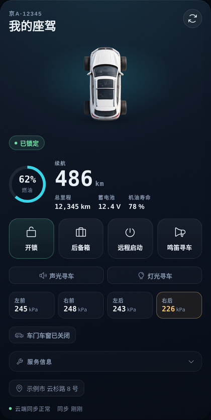

<div align="center">

# 爱车卡片 · ha-car

**给 [福特派互联（FordPass CN）](https://github.com/RockJesus/ha-fordpass-cn) / 林肯之道 做的一张仪表台级 Lovelace 卡片**

车况一屏读完 · 长按防误触控车 · 全可视化配置

[](https://github.com/RockJesus/ha-car/releases/latest)
[](https://www.home-assistant.io/)
[](https://hacs.xyz)
[](LICENSE)

</div>

<p align="center">
  
  
</p>

## 这是什么

一张替代「实体罗列卡」的车辆卡片。它按本车**实际具备的能力**渲染：汽油车不会出现充电模块，没有俯视图就自动退回 3D / 侧视图，实体缺失的模块整块不出现。

- **车辆驾驶舱视觉**：俯视/3D 车型图作主视觉，深蓝黑漆面 + 车机背光青，只有一处强调色。
- **一屏完成日常操作**：车锁、后备箱、远程启动、鸣笛、声光/灯光寻车、云端刷新。
- **长按防误触**：后备箱、开锁、上锁、远程启动、鸣笛默认需要按住 0.7 秒，松手太早只提示不动作；时长与动作清单都可改。
- **四轮胎压单行仪表条**：数值按「推荐胎压 / 胎状态」判据变色，异常那一格直接亮。
- **门窗开合态**：只显示真正开启的门/窗/尾门/引擎盖，全部关闭时收敛成一枚「已关闭」。
- **充电域按车型出现**：SOC、充电状态、立即/停止充电、家充桩、上次充电电量。
- **服务信息折叠区**：保养计划、召回、未读消息、车机固件、客服电话，不占主视觉高度。
- **执行反馈**：指令发出后按钮带脉冲点，等云端状态真正翻转才消；失败给明确报错。
- **车辆离线置灰**：`onlinernr` 判定离线时操作区降透明，避免按了没反应。

## 安装

### 市场（HACS）

1. HACS → 右上角菜单 → **自定义仓库**
2. 地址填 `https://github.com/RockJesus/ha-car`，类别选 **Dashboard / 前端插件**
3. 搜索「爱车卡片」→ 下载 → 浏览器强制刷新（App 需杀进程重开）

卡片是纯前端资源，**不需要重启 Home Assistant**。

### 手动

1. 下载 [`ha-car.js`](https://github.com/RockJesus/ha-car/releases/latest/download/ha-car.js)
2. 放到 `/config/www/ha-car.js`
3. 设置 → 仪表盘 → 资源 → 添加 `/local/ha-car.js`，类型 **JavaScript Module**

## 添加卡片

仪表盘 → 添加卡片 → 搜索「爱车卡片」，或直接写 YAML：

```yaml
type: custom:ha-car
```

**不需要填实体。** 卡片按集成的实体前缀（`sha256(VIN)` 前 16 位）自动识别车辆；账号下只有一辆车时连车辆都不用选，多辆车在可视化编辑器里选一台即可。

## 配置

| 键 | 类型 | 默认 | 说明 |
|---|---|---|---|
| `hash` | string | 自动 | 车辆实体哈希前缀；由编辑器选择车辆时写入 |
| `device` | string | — | 也可直接给设备 ID，卡片读注册表换算哈希 |
| `title` | string | 车辆昵称 | 卡片标题，留空取 `vehicle_nickname` |
| `show_plate` | bool | `true` | 顶部是否显示车牌 |
| `layout` | `full` / `compact` | `full` | `compact` 只留主视觉、状态、续航与操作，适合手机首屏 |
| `modules` | list | 全部 | `status` `actions` `energy` `tires` `doors` `charging` `alerts` `service` |
| `confirm` | list | 5 项 | 需要长按的动作键，见下表 |
| `hold_ms` | number | `700` | 长按时长，300–3000 |
| `accent` | string | `#37d6e8` | 强调色（仪表背光青） |
| `image` | string | `auto` | `auto` / `overlook` / `3d` / `side` / `custom` / 实体 ID / URL |
| `image_url` | string | — | `image: custom` 时使用的图片地址 |
| `entities` | object | `{}` | 逐槽位覆盖实体，键名见下表 |

需要长按的动作键：`btn_unlock` 开锁、`btn_lock` 上锁、`btn_trunk` 后备箱、`sw_engine` 远程启动/熄火、`sw_honk` 鸣笛、`sw_va` 声光寻车、`sw_light` 灯光寻车。

```yaml
# 例子：只留车况与操作，开锁也要长按，强调色换成冰蓝
type: custom:ha-car
layout: compact
modules: [status, actions, energy]
confirm: [btn_unlock, btn_lock, btn_trunk, sw_engine]
accent: "#6ea8ff"
```

### 实体覆盖（可选）

实体 ID 被改过、或一台车挂了多个集成时，在 `entities` 里按槽位指定即可；其余槽位仍走自动识别：

```yaml
entities:
  fuel: sensor.my_fuel_level
  tracker: device_tracker.my_car
```

可用槽位：`lock` `fuel` `battery` `range` `ev_range` `odo` `volt` `oil` `tp_lf` `tp_rf` `tp_lr` `tp_rr` `door_fl` `door_fr` `door_rl` `door_rr` `tailgate` `hood` `win_fl` `win_fr` `tracker` `addr` `chg_status` `alerts` `maint` `recall` `messages` `sync` `data_time` `btn_lock` `btn_unlock` `btn_trunk` `btn_refresh` `sw_engine` `sw_honk` `sw_va` `sw_light`。

## 操作反馈怎么读

| 现象 | 含义 |
|---|---|
| 按住出现一条青色进度线 | 正在计时；走满后按钮描边变青、震动提示，松手即执行 |
| 轻点一下就松手 | 只弹「长按 0.7 秒执行」，不发指令 |
| 按钮右上角脉冲小点 | 指令已发出，等云端状态翻转（集成会跟随云端快照，通常十几秒到一分钟） |
| 底部青色条 | 指令已发送 / 刷新已请求 |
| 底部红色条 | 发送失败，带错误原因 |

## 与集成的对应关系

卡片读取的都是集成现有实体，不新增后端。状态值按中英文模糊匹配（`已锁定` / `locked`、`开启` / `open`），所以界面语言切换后照样成立；充电中优先读 `charging_status` 的 `evcc_charge_state` 属性。

## 开发

```bash
npm install
npm run build      # esbuild 打成单文件 ESM → ha-car.js
npm run lint
python3 scripts/check_bundle.py
```

`dev/harness.html` 是带 mock 实体的渲染台，浏览器直接打开即可改样式看效果（需要起一个静态服务器，ESM 不能走 `file://`）。

## 版本

三段十进制，段内不进两位数：`1.0.9` 之后是 `1.1.0`。变更见 [Releases](https://github.com/RockJesus/ha-car/releases)。

## 免责声明

个人自用项目，与福特汽车（中国）、长安福特、林肯中国**无任何关联、未获授权**；「福特派」「林肯之道」商标归各自权利人所有，此处仅用于说明对接对象。卡片只做本机前端渲染，不向任何第三方上传数据。使用风险自负。
